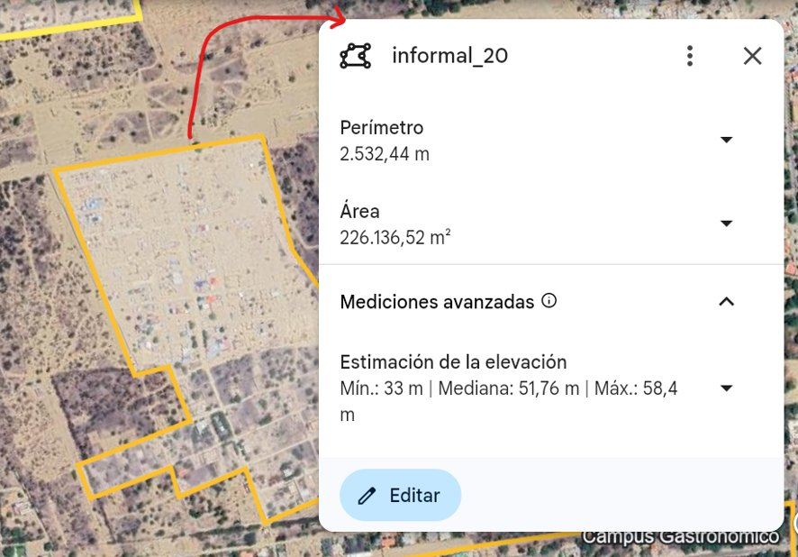
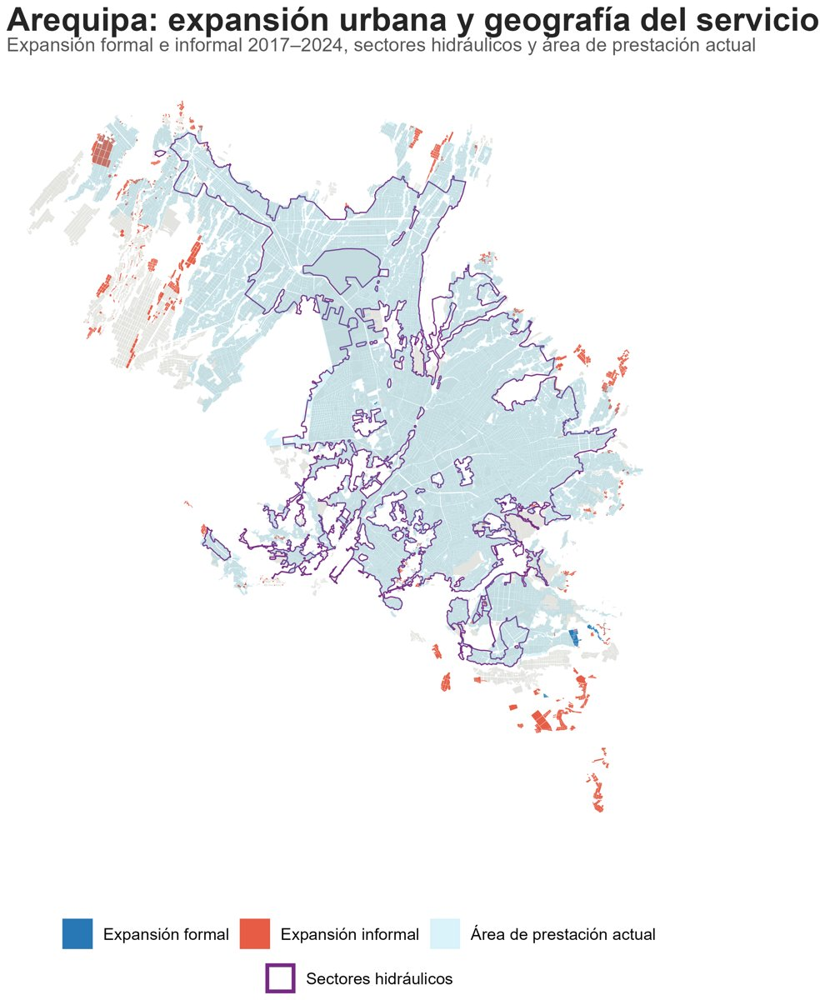
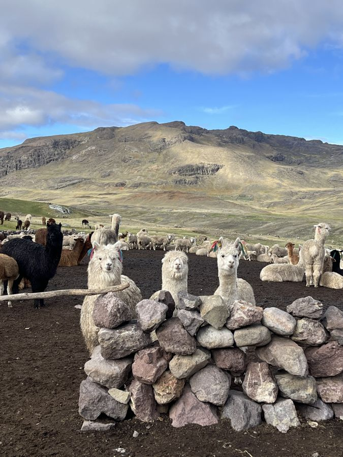
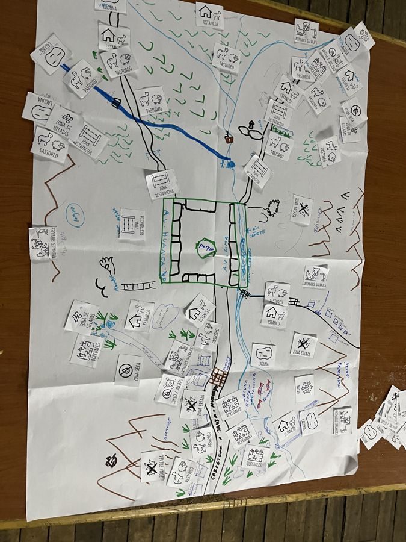
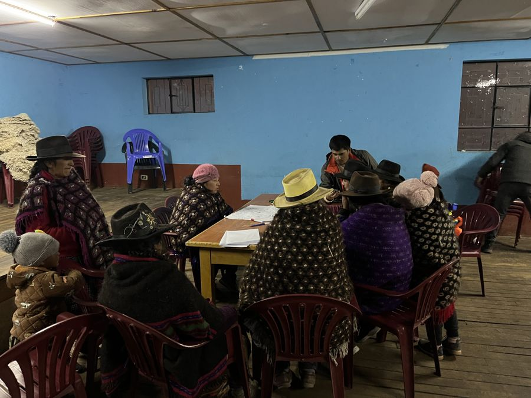
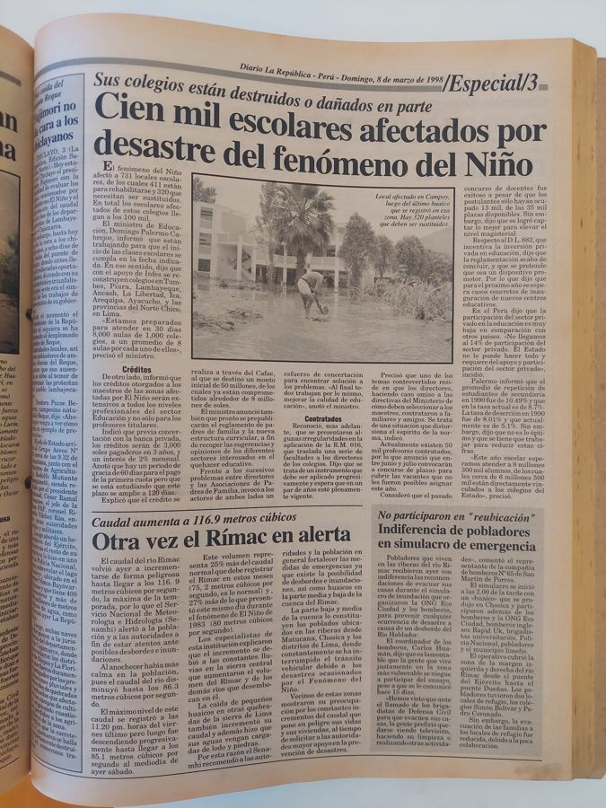
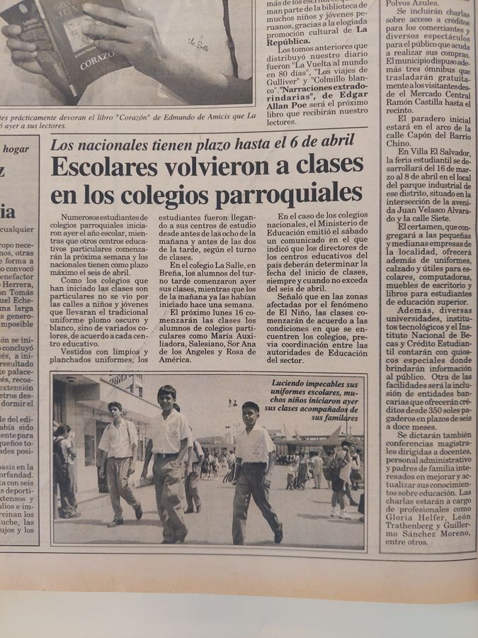
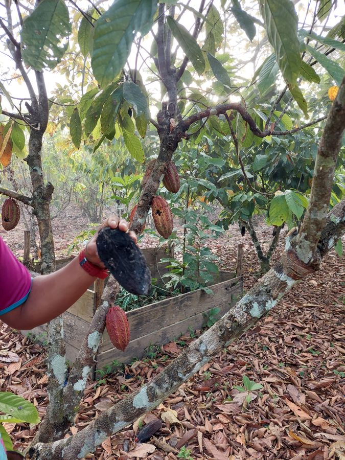
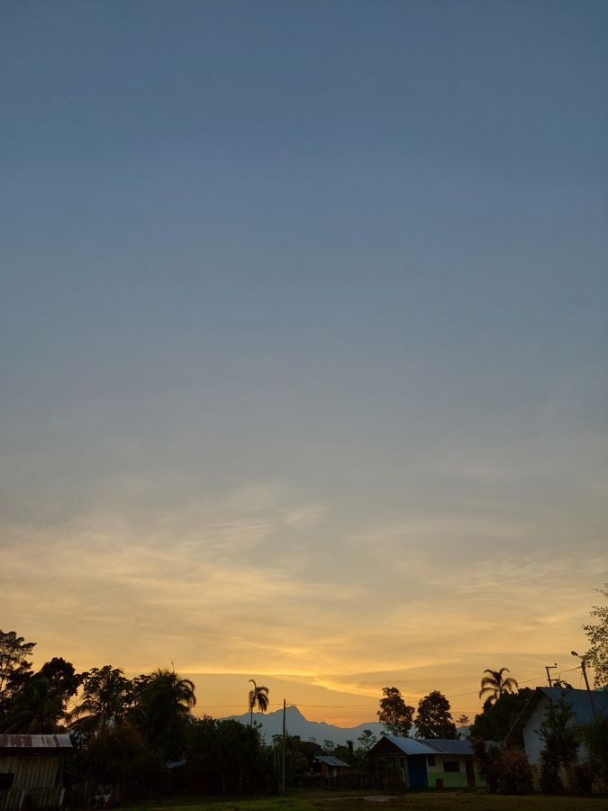

Soy socióloga por la Pontificia Universidad Católica del Perú y asistente de investigación en GRADE (Grupo de Análisis para el Desarrollo). Trabajo con métodos mixtos: de la entrevista y el taller en comunidades altoandinas a la ENDES, los datos geoespaciales y el procesamiento de lenguaje natural. Me interesa producir evidencia rigurosa sobre el Perú y medir mejor lo social.

## Formación

- **Bachiller en Sociología**, PUCP (2020–2025). Tercer mejor promedio de la carrera. Miembro del Grupo de Investigación en Estado y Sociedad (GIES).
- **Diplomatura en Ciencia de Datos para las Ciencias Sociales y la Gestión Pública**, Q-Lab PUCP (2026–2027), con beca del 50 % por mérito académico.

## Qué hago

- **Investigación aplicada.** En GRADE integro datos censales, geoespaciales y entrevistas con expertos para analizar la expansión urbana y las brechas de acceso al agua potable en ocho ciudades peruanas.
- **Diseño de mediciones.** Contribuí al rediseño de una encuesta nacional urbana con metodología CAP y capacité a equipos de campo y técnicos para supervisar y replicar mediciones.
- **Trabajo de campo.** Observación participante, entrevistas y talleres sobre estrategias comunales frente a crisis socioambientales en la sierra.
- **Datos y código.** Python y R para microdatos, mapas, NLP y, ahora, agentes de IA que consultan datos oficiales.

## Proyectos



  
  

    <h3 style="margin-top:0"><a href="{{ post.url | relative_url }}">{{ post.title }}</a></h3>
    
{{ post.excerpt | markdownify | strip_html }}

    <a href="{{ post.url | relative_url }}">Ver proyecto →</a>
  



## Trabajo de campo

<h3>Expansión urbana y acceso al agua en ocho ciudades</h3>

GRADE, por encargo de la Confederación de Desarrolladores Inmobiliarios del Perú (CODIP) · 2026 · Asistente de investigación

<figure><figcaption>Proceso: clasificación manual de la expansión. Imagen satelital: Google Earth.</figcaption></figure><figure><figcaption>Resultado: expansión formal e informal en Arequipa, 2017–2024.</figcaption></figure>

Colaboré en la estimación de cuántas de las nuevas edificaciones levantadas entre 2017 y 2024 en Arequipa, Chiclayo, Huancayo, Ica, Lima, Piura, Tarapoto y Trujillo acceden a agua potable. Combiné la cartografía oficial de manzanas, Open Buildings y datos de SUNASS, y clasifiqué a mano la expansión formal e informal con imágenes satelitales y Street View.

Resultados preliminares en El Comercio: <a href="https://elcomercio.pe/economia/obras-de-saneamiento-demoraron-casi-dos-anos-en-pasar-de-las-inmobiliarias-a-las-empresas-de-agua-segun-grade-noticia/" target="_blank" rel="noopener">nota 1</a> · <a href="https://elcomercio.pe/lima/sucesos/la-ciudad-crece-mas-rapido-que-las-redes-de-agua-por-que-la-brecha-sigue-aumentando-pese-a-la-inversion-apuesplan-noticia/" target="_blank" rel="noopener">nota 2</a>

<h3>Familias ganaderas frente a crisis en Tanta, Yauyos</h3>

GRADE · noviembre–diciembre 2024 · Asistente de investigación en campo

Tres semanas en campo para una investigación ganadora de CONCYTEC-PROCIENCIA. Entrevisté a actores de tres niveles: familias ganaderas, organizaciones comunales y de base, e instituciones públicas presentes en el territorio. Con madres ganaderas facilité talleres de mapa parlante y línea de tiempo, y con adolescentes, uno sobre proyectos de vida. También visité estancias de pastoreo.

<a href="https://doi.org/10.18800/kawsaypacha.202602.A018" target="_blank" rel="noopener">Leer el artículo en Kawsaypacha</a>

<h3>El Fenómeno del Niño y la escuela peruana</h3>

PUCP-CISE · enero 2024 · Asistencia de investigación documental

En la Biblioteca Central de la PUCP fotografié y sistematicé prensa de los episodios de 1982-1983, 1997-1998 y 2016-2017 para reconstruir cómo respondió el Estado ante el impacto del Niño en las escuelas. El trabajo alimentó el libro de Manuel Etesse (PUCP, 2025).

<a href="http://hdl.handle.net/20.500.14657/206922" target="_blank" rel="noopener">Ver la publicación</a>

<h3>Cacao y cambio climático en Chazuta, San Martín</h3>

Curso de trabajo de campo, PUCP · octubre 2023 · Co-investigadora, en un equipo de tres

Entrevisté a familias cacaoteras de tres generaciones, a ingenieros de una cooperativa y de una ONG, y a la lideresa de una organización local de mujeres. Facilité un taller de mapa parlante para ubicar zonas protegidas, de avistamiento de fauna y donde más se nota el cambio climático. Encontramos una nueva ruralidad con economías familiares diversificadas: cacao, piscicultura, chocolate, ropa, caucho y hotelería.

## Publicaciones



<a href="{{ post.url | relative_url }}"><b>{{ post.title }}</b></a> {{ post.citation }}



## Docencia

- Co-diseñé y co-dicté, con Lucía Díaz, el [Taller Introductorio de Python aplicado a Ciencias Sociales](https://github.com/brisacruz22/python-para-ccss) (Q-Lab PUCP, 2024).
- Asistente de docencia en el Diplomado en Ciencia de Datos para las Ciencias Sociales y la Gestión Pública (ediciones 2024 y 2025).

## CV

<a href="/files/cv-brisa-cruz.pdf" target="_blank" rel="noopener">Visualizar el CV en PDF</a>
