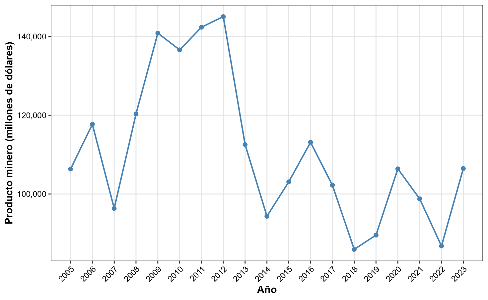

*Valor de la producción minera, 2005–2023 (millones de dólares). Figura de la tesis.*

**Pregunta.** ¿La actividad minera cambia el empoderamiento de las mujeres en la sierra peruana?

**Datos y método.** Integré microdatos de la Encuesta Demográfica y de Salud Familiar (ENDES) con la producción minera distrital del SIRTOD (INEI) para construir medidas extensivas e intensivas de exposición minera. Estimé regresiones lineales ponderadas que respetan el diseño muestral de la ENDES, con análisis de heterogeneidad y de mecanismos, para seis indicadores de empoderamiento.

**Resultado.** Vivir a menos de 10 km de un distrito minero se asocia con 2.4 puntos porcentuales menos de exclusión de las decisiones de compras grandes del hogar y 3 puntos menos de trabajo no remunerado. Solo dos de los seis indicadores se mueven, y estas asociaciones se atenúan en mujeres indígenas, mayores de 30 años o con secundaria completa. La minería transforma el empoderamiento de forma fragmentada: más inserción laboral no se traduce automáticamente en más autonomía.

*Tesis de bachillerato en Sociología, PUCP (2025).*
