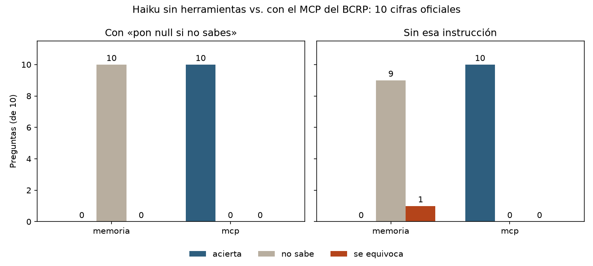

**Pregunta.** ¿Puede un asistente de IA responder con datos macroeconómicos oficiales, con su fuente, en lugar de cifras de memoria?

**Qué hice.** Construí en Python un servidor MCP (Model Context Protocol) que conecta a Claude con las series estadísticas del Banco Central de Reserva del Perú, y lo evalué con 10 preguntas sobre cifras oficiales.

**Resultado.** Con el MCP, el modelo acertó las 10 cifras. Sin herramientas no acertó ninguna: cuando se le permitió decir «no sé», no respondió ninguna; sin esa instrucción, dejó 9 sin responder y dio una cifra equivocada.

*Proyecto de la diplomatura en Ciencia de Datos para las Ciencias Sociales y la Gestión Pública (Q-Lab PUCP).*

[Código en GitHub](https://github.com/brisacruz22/mcp-bcrp)
