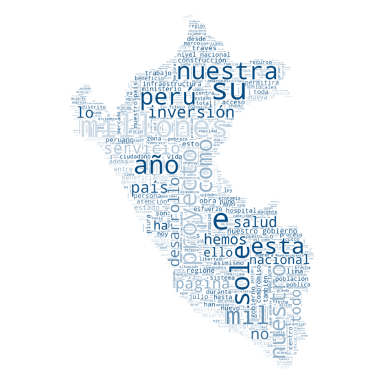
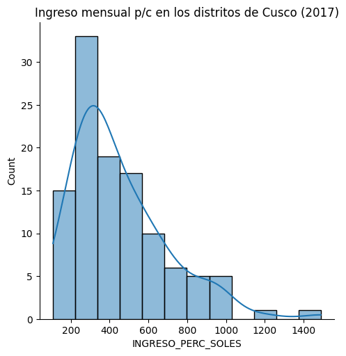

  
  

**Para quién.** Estudiantes de Sociología, Ciencia Política, Antropología y disciplinas afines que empiezan a programar.

**Qué cubre.** Cinco notebooks: importación, limpieza y exploración de datos con Pandas; estadística descriptiva; gráficos con Matplotlib y Seaborn; mapas con GeoPandas y Folium; y una introducción al análisis cualitativo de texto con Python.

**Mi rol.** Co-diseñé y co-dicté el taller con Lucía Díaz para el Laboratorio de Inteligencia Artificial y Métodos Computacionales en Ciencias Sociales (Q-Lab) de la Facultad de Ciencias Sociales de la PUCP.

[Materiales en GitHub](https://github.com/brisacruz22/python-para-ccss)
